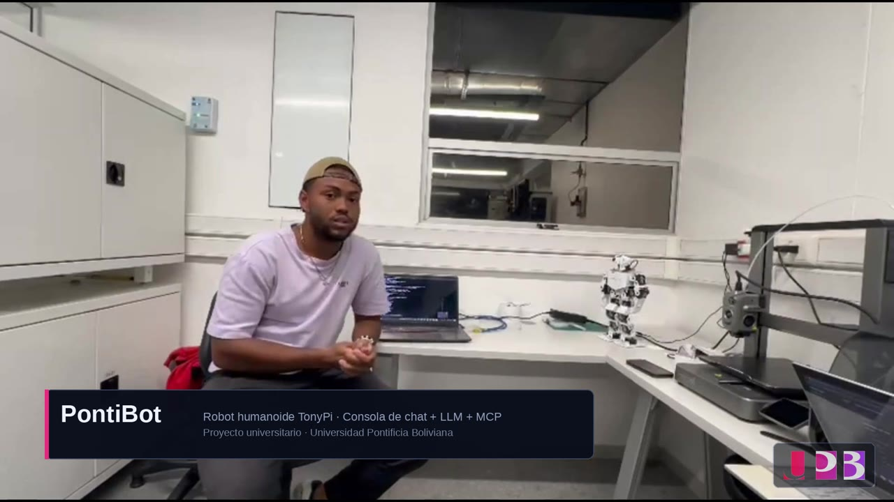
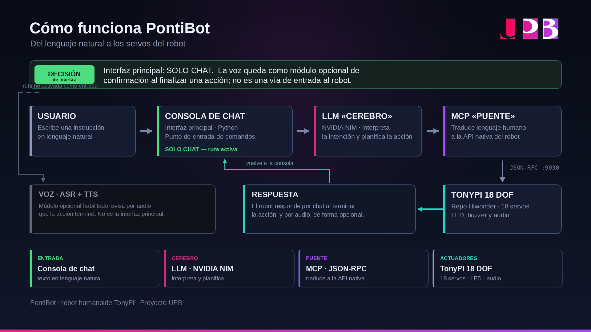
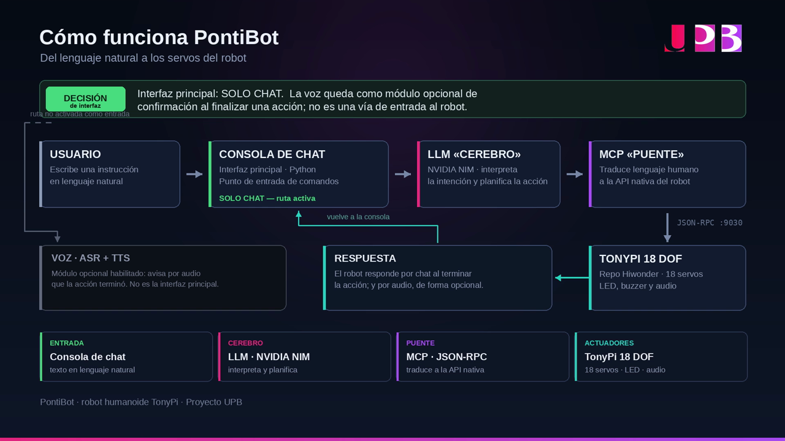

<div align="center">


# PontiBot

**Robot humanoide TonyPi 18 DOF controlado con lenguaje natural.**

*El PC piensa, el robot ejecuta.*

[](https://github.com/danielCH26/PontiBot)
[](LICENSE)
[](https://www.python.org/)
[](pc/server.py)
[](https://www.upb.edu/)

</div>

---

## 📹 Video del proyecto

<a href="media/PontiBot_UPB.mp4" target="_blank">
  
</a>

> ▶️ **Haz clic en la imagen para reproducir el video** (`.mp4`, 1080p, 3 min 11 s).
> En GitHub se abre en una pestaña nueva; si prefieres, <a href="media/PontiBot_UPB.mp4">descárgalo aquí</a>.
> Es el mismo corte que se proyecta en la feria.

**Qué muestra el video:** la consola de chat en acción (`saluda`, `camina hacia adelante`, `haz una sentadilla`, `haz una venia`), el diagrama de arquitectura en pantalla completa y la ficha técnica del robot.

---

## ¿Qué es PontiBot?

PontiBot convierte al **TonyPi** —un robot humanoide de 18 grados de libertad de Hiwonder— en un sistema que
entiende **lenguaje natural**. Escribes una orden en texto plano y el robot la ejecuta: saluda, camina, se
reverencia, hace una sentadilla, te muestra lo que ve con la cámara.

El proyecto es una **ingeniería inversa** del firmware oficial de Hiwonder: se estudió el protocolo JSON-RPC que
el robot ya expone y se construyó encima un servidor **MCP** (Model Context Protocol) con **26 herramientas**,
un cliente que habla con un **LLM** y un agente que decide qué herramienta usar en cada turno.



- **El PC es el cerebro.** Llamadas a la API, LLM, ASR, TTS, memoria y acceso al micrófono.
- **El robot es el ejecutor.** Recibe órdenes por JSON-RPC y las traduce a movimiento real.
- **El robot no necesita internet.** Solo necesita estar en la misma red que el PC.

> 📸 El mismo diagrama aparece a pantalla completa en el video, entre el segundo 2:24 y el 2:38:
> 

---

## ⚡ Arranque rápido (5 minutos)

```bash
git clone https://github.com/danielCH26/PontiBot.git
cd PontiBot

# 1. Comprueba que todo está en su sitio
bash tools/check_repo.sh

# 2. Entorno de Python (≥ 3.10: el SDK `mcp` lo exige)
python3 -m venv .venv && source .venv/bin/activate
pip install -r requirements.txt

# 3. Configura la clave y la IP del robot
cp .env.example .env && chmod 600 .env
$EDITOR .env          # → LLM_API_KEY=nvapi-...   y   TONYPI_HOST=192.168.149.1

# 4. ¡Habla con el robot!
cd pc && python3 voice_agent.py --chat
```

```text
pontibot> saludar
  -> robot_do_action({"action":"wave"})
     ejecutando wave x1
  pontibot: Saludo. Soy PontiBot.

pontibot> camina hacia adelante
  -> robot_walk({"direction":"forward","steps":3})
```

> 🔑 La clave gratuita se crea en <https://build.nvidia.com/settings> (endpoint compatible con OpenAI).
> 🤖 El detalle paso a paso, con verificación, *rollback* y matriz de fallos, está en
> **[docs/GUIA-DESPLIEGUE.md](docs/GUIA-DESPLIEGUE.md)**.

---

## 📖 Documentación

| Documento | Para qué |
|---|---|
| **[docs/MANUAL-DE-USO.md](docs/MANUAL-DE-USO.md)** | 📘 **Manual de uso completo**: interfaz, comandos, herramientas, troubleshooting y mantenimiento |
| **[docs/ARQUITECTURA.md](docs/ARQUITECTURA.md)** | 🏗️ **Diagramas** del sistema: arquitectura, estructura del proyecto, flujo de un turno y protocolo |
| [docs/GUIA-DESPLIEGUE.md](docs/GUIA-DESPLIEGUE.md) | Guía de despliegue en 11 fases, desde el primer contacto con el robot |
| [docs/ESTRUCTURA-PROYECTO.md](docs/ESTRUCTURA-PROYECTO.md) | Mapa fichero a fichero: qué hace cada archivo y dónde se ejecuta |
| [docs/GUIA_WIFI.md](docs/GUIA_WIFI.md) | Las 6 vías para darle red al robot, con árbol de decisión y FAQ |
| [docs/NVIDIA.md](docs/NVIDIA.md) | Comparativa de modelos LLM con tiempos medidos y criterio de elección |
| [docs/PLAN.md](docs/PLAN.md) | Qué se modifica en el robot y por qué |
| [docs/arquitectura-bot-tonypi.html](docs/arquitectura-bot-tonypi.html) | Diagrama de arquitectura en HTML (ábrelo en el navegador) |
| [docs/legacy/](docs/legacy/) | Documentación del diseño anterior (el agente dentro del robot) |

**Material de feria:** [`media/banner-rollup-100x200cm.pdf`](media/banner-rollup-100x200cm.pdf) — banner vertical
100 × 200 cm con sangrado de 3 mm y marcas de corte, listo para imprenta
([vista previa](media/banner-preview.png)).

---

## 🗂️ Cómo está estructurado el proyecto

```mermaid
graph TD
    ROOT["PontiBot/"] --> PC["pc/ · runtime (se ejecuta en el PC)"]
    ROOT --> TOOLS["tools/ · verificación y operación"]
    ROOT --> ROBOT["robot/ · servicio 'solo RPC' (opcional)"]
    ROOT --> PATCH["patches/robot_patch/ · parche de firmware (opcional)"]
    ROOT --> TESTS["tests/ · tests y stub del SDK mcp"]
    ROOT --> DOCS["docs/ · documentación"]
    ROOT --> MEDIA["media/ · video y banner"]
    ROOT --> ASSETS["assets/ · logo y póster"]

    PC --> VA["voice_agent.py<br/>agente: VAD · ASR · LLM · tools · TTS"]
    PC --> SRV["server.py<br/>servidor MCP · 26 tools"]
    PC --> CLI["tonypi_client.py<br/>cliente JSON-RPC (sin dependencias)"]
    PC --> AUX["vad · prompts · tool_parse<br/>memory · storage · mcp_bridge"]

    TOOLS --> T1["check_repo · env_check · nvidia_check"]
    TOOLS --> T2["find_robot · set_robot_ip · test_movimientos"]
    TOOLS --> T3["mock_robot · selftest · e2e_mcp_test"]

    TESTS --> ST["mcp_stub/ · stub del SDK mcp"]

    style PC fill:#1b2a4a,stroke:#3b82f6,color:#e2e8f0
    style TOOLS fill:#2a1b3d,stroke:#a855f7,color:#e2e8f0
    style ROBOT fill:#0f3a34,stroke:#2dd4bf,color:#e2e8f0
    style PATCH fill:#3a1220,stroke:#e4257f,color:#e2e8f0
    style TESTS fill:#3a2e12,stroke:#f59e0b,color:#e2e8f0
    style DOCS fill:#1a1a2e,stroke:#6b7280,color:#e2e8f0
```



| Carpeta | Qué hay | Dónde se ejecuta |
|---|---|---|
| `pc/` | El runtime completo: agente, servidor MCP, cliente RPC, VAD, prompts, memoria | **PC** |
| `tools/` | Verificación y operación: `check_repo.sh`, `env_check.sh`, `nvidia_check.sh`, `find_robot.sh`, `selftest.py`, `mock_robot.py`… | **PC** |
| `robot/` | Servicio "solo RPC" (sin modo de prueba) + su unidad systemd | **Robot** (opcional) |
| `patches/` | Parche de firmware del robot (`SetBuzzer`, `PlayAudio`, `Speak`), reversible | **Robot** (opcional) |
| `tests/` | Tests del agente y stub del SDK `mcp` | **PC** |
| `docs/` | Manuales, guías y diagramas | — |
| `media/` | Video del proyecto y banner de feria | — |

Detalle fichero a fichero: **[docs/ESTRUCTURA-PROYECTO.md](docs/ESTRUCTURA-PROYECTO.md)**.

---

## 🛠️ Las 26 herramientas MCP

El servidor `pc/server.py` publica un catálogo de herramientas que el LLM elige en cada turno.

| Grupo | Herramientas |
|---|---|
| **Estado** | `robot_ping` · `robot_status` · `robot_list_actions` |
| **Movimiento** | `robot_do_action` · `robot_walk` · `robot_stop` · `robot_look` · `robot_stand_up` |
| **Servos** | `robot_read_servos` · `robot_set_body_servo` · `robot_power_down_servos` |
| **Visión** | `robot_start_vision` · `robot_stop_vision` · `robot_vision_status` · `robot_read_camera_rgb` · `robot_camera_snapshot` |
| **Color y detección** | `robot_set_color_threshold` · `robot_get_color_thresholds` · `robot_set_detection_point` · `robot_set_detection_threshold` |
| **Audio y archivos** | `robot_beep` · `robot_play_audio` · `robot_say` · `robot_list_audio` · `robot_list_files` · `robot_read_file` |

> 🤖 Estas herramientas se publican además como un **servidor MCP** estándar por `stdio`, así que puedes
> conectarlo a cualquier cliente MCP (Claude Desktop, Claude Code, IDEs…) con el bloque de
> [docs/legacy/mcp-config.example.json](docs/legacy/mcp-config.example.json).

---

## 🧠 El modelo de lenguaje

| | |
|---|---|
| **Proveedor** | [NVIDIA NIM](https://build.nvidia.com) — endpoint compatible con OpenAI |
| **Modelo** | `nvidia/nemotron-3.5-bolt-e4b` |
| **Por qué este** | Chat **0,52 s** · *tool calling* **0,35 s** · visión ✓ · **6/6** en la prueba semántica |
| **Alternativa** | `minimaxai/minimax-m3.1-flash` (más lento y verboso) |
| **Descartado** | `deepseek-ai/deepseek-v4.1-flash` → capaz, pero **150–200 s por turno**: inviable para un robot |

Los tiempos y la comparativa completa están en **[docs/NVIDIA.md](docs/NVIDIA.md)**.

---

## 🤖 El robot

| | |
|---|---|
| **Modelo** | TonyPi 18 DOF — kit Standard de Hiwonder |
| **Grados de libertad** | 18 (16 servos del cuerpo + 2 de la cabeza) |
| **Base** | Raspberry Pi 4B · **Raspbian Buster** (Python 3.7) |
| **Protocolo** | JSON-RPC 2.0 en el puerto **9030** · snapshot JPEG en el **8080** |
| **Actuadores** | 18 servos · LED · buzzer · cámara RGB |
| **Visión** | Detección de color, rostros y etiquetas AprilTag |
| **Acceso de fábrica** | Hotspot `HW-<serial>` / contraseña `hiwonder` · SSH `pi@192.168.149.1` |

> ⚠️ El firmware oficial **no expone** `SetBuzzer`, `PlayAudio` ni `Speak`. El parche opcional
> [`patches/robot_patch/`](patches/robot_patch/) los añade de forma **reversible**.

---

## 🧪 Verificar sin robot

Perfecto para desarrollar o para un CI. Cada script **levanta el simulador por su cuenta**:

```bash
python3 tools/selftest.py         # 28/28 checks del protocolo real
python3 tests/test_memory.py      # 32 checks
python3 tests/test_storage.py     # 34 checks
python3 tools/e2e_mcp_test.py     # 33 checks, extremo a extremo del servidor MCP
```

Ojo: `tools/e2e_mcp_test.py`arranca `pc/server.py` como proceso real y le habla MCP por `stdio`
(`initialize` → `tools/list` → `tools/call`).

---

## 🩺 Troubleshooting rápido

| Síntoma | Causa probable | Solución |
|---|---|---|
| `E04 - Operation timeout!` en cada llamada | El robot tiene una **función de juego** cargada y el hilo principal está ocupado | `curl -s -X POST http://<IP>:9030/ -d '{"jsonrpc":"2.0","method":"UnloadFunc","params":[],"id":1}'` |
| El robot responde pero **no se mueve** | El modelo escribió la llamada como texto plano | Ya está compensado en `pc/tool_parse.py`; no lo quites |
| `Missing request extension … axum::Extension` | **Bearer vacío**: la clave no se leyó | `bash tools/env_check.sh` y comprueba que `LLM_API_KEY` no está vacía |
| HTTP 403 contra NVIDIA **desde el robot** | Bloqueo del WAF por ruta de salida | El LLM se llama **desde el PC**, nunca desde el robot |
| El bot no te oye (VAD mudo) | El micrófono no está en ALSA | `bash tools/audio_probe.sh` — en WSLg/BT el dispositivo es `RDPSource` |
| Sin internet en el robot | Está en modo AP (hotspot) | El robot **no necesita** internet; el PC sí. Ver [GUIA_WIFI.md](docs/GUIA_WIFI.md) |

La matriz completa está en **[docs/MANUAL-DE-USO.md](docs/MANUAL-DE-USO.md)**.

---

## 🔐 Secretos

La clave de NVIDIA **nunca** se sube al repositorio:

- `.env` está en `.gitignore` y solo existe en tu máquina con permisos `600`.
- `.env.example` es la plantilla con los valores de ejemplo.
- Si alguna vez has compartido el `.env` (por ejemplo, en un zip), **rota la clave** en
  <https://build.nvidia.com/settings>.

---

## 🎓 Contexto

Proyecto universitario de la **Universidad Pontificia Boliviana (UPB)**: ingeniería inversa del firmware de
Hiwonder para el TonyPi y construcción de un servidor MCP que permite controlarlo con lenguaje natural.

---

## 📄 Licencia

MIT — ver [LICENSE](LICENSE). El firmware de Hiwonder del robot **no** se incluye en este repositorio.
