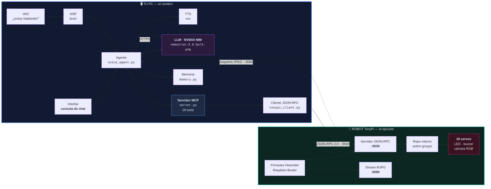
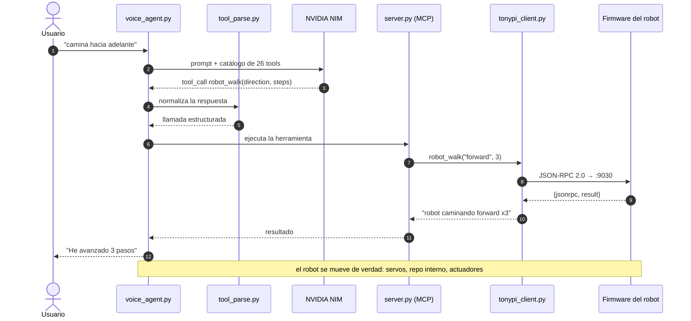
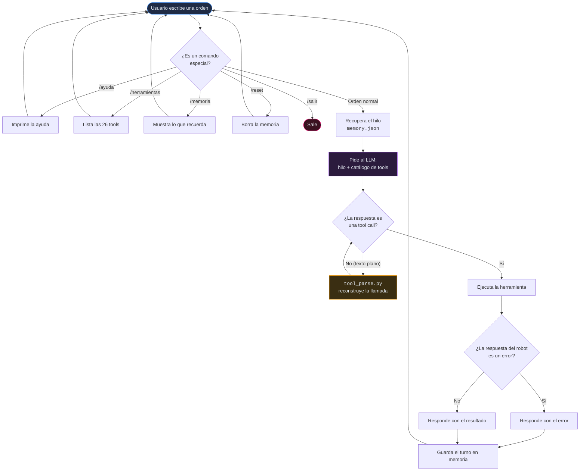
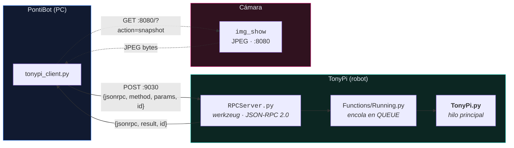
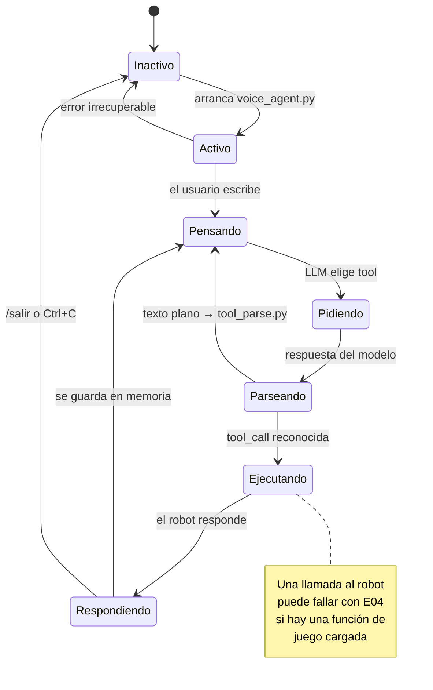

# 🏗️ Arquitectura de PontiBot

> Diagramas del sistema: arquitectura general, estructura del proyecto, el flujo de un turno completo
> y el protocolo con el robot.
>
> Documento complementario de [MANUAL-DE-USO.md](MANUAL-DE-USO.md).

---

## 📑 Índice

1. [Arquitectura general](#1-arquitectura-general)
2. [Estructura del proyecto](#2-estructura-del-proyecto)
3. [El flujo de un turno](#3-el-flujo-de-un-turno)
4. [Protocolo con el robot](#4-protocolo-con-el-robot)
5. [Ciclo de vida del MCP](#5-ciclo-de-vida-del-mcp)
6. [Decisiones de diseño](#6-decisiones-de-diseño)

---

## 1. Arquitectura general

**El PC es el cerebro, el robot es el ejecutor.** Esa es la decisión que define todo el proyecto.

### Reparto de responsabilidades

| Pieza | Dónde vive | Por qué |
|---|---|---|
| LLM, ASR, TTS, memoria | **PC** | El robot tiene Python 3.7 y el SDK `mcp` exige 3.10 |
| Servidor MCP (26 tools) | **PC** | Idem: `mcp` no se puede instalar en Raspbian Buster |
| Micrófono y altavoz | **PC** | Auricular BT o WSLg; el robot no usa su altavoz |
| JSON-RPC y ejecución | **Robot** | Es el firmware de fábrica, que ya expone el protocolo |
| Internet | **Solo el PC** | El robot puede quedarse sin red sin que nada falle |

> 💡 El firmware **ya expone** JSON-RPC 2.0 en el puerto 9030. No hubo que invertir el protocolo:
> se descubrió y se envoltió.

---

## 2. Estructura del proyecto

```mermaid
graph TD
    subgraph ROOT["📦 PontiBot/"]
        direction TB

        subgraph RUNTIME["🧠 pc/ — runtime (PC)"]
            direction LR
            VA["<b>voice_agent.py</b><br/>VAD·ASR·LLM·TTS<br/>+ bucle de chat"]
            SRV["<b>server.py</b><br/>servidor MCP<br/>26 tools"]
            MCB["mcp_bridge.py<br/>cliente MCP stdio"]
            CLI["tonypi_client.py<br/>cliente JSON-RPC<br/>sin dependencias"]
            AUX["vad.py<br/>prompts.py<br/>tool_parse.py"]
            AUX2["memory.py<br/>storage.py<br/>audio_doctor.py"]
            VA --- MCB
            VA --- AUX
            VA --- AUX2
            MCB --- SRV
            SRV --- CLI
        end

        subgraph OPS["🧰 tools/ — operación"]
            direction LR
            T1["<b>check_repo.sh</b><br/><b>env_check.sh</b><br/><b>nvidia_check.sh</b>"]
            T2["<b>find_robot.sh</b><br/><b>set_robot_ip.sh</b><br/><b>test_movimientos.sh</b>"]
            T3["<b>audio_probe.sh</b><br/><b>bt_headset_pc.sh</b><br/><b>wslg_check.sh</b>"]
            T4["<b>tonypi_wifi.sh</b><br/><b>net_doctor.py</b><br/><b>storage_doctor.py</b>"]
            T5["<b>mock_robot.py</b><br/><b>selftest.py</b><br/><b>e2e_mcp_test.py</b>"]
            T6["<b>nvidia_models.py</b><br/><b>nvidia_smoke_test.py</b>"]
        end

        subgraph RBT["🤖 robot/ — en el robot (opcional)"]
            direction LR
            R1["TonyPi_rpc_only.py<br/>firmware sin modo de prueba"]
            R2["tonypi-rpc.service<br/>unidad systemd"]
        end

        subgraph PATCH["🩹 patches/robot_patch/ — en el robot (opcional)"]
            direction LR
            P1["RPCServer_extra.py<br/>SetBuzzer · PlayAudio · Speak"]
            P2["apply_patch.py<br/>(+ --revert)"]
        end

        subgraph TEST["🧪 tests/"]
            direction LR
            TS1["test_memory.py"]
            TS2["test_storage.py"]
            TS3["test_live_memory.py"]
            TS4["mcp_stub/<br/>stub del SDK mcp"]
        end

        subgraph DOC["📖 docs/"]
            direction LR
            D1["MANUAL-DE-USO.md<br/><b>ARQUITECTURA.md</b>"]
            D2["GUIA-DESPLIEGUE.md<br/>ESTRUCTURA-PROYECTO.md"]
            D3["GUIA_WIFI.md<br/>NVIDIA.md · PLAN.md"]
            D4["legacy/"]
        end

        subgraph MED["🎬 media/ + assets/"]
            direction LR
            M1["PontiBot_UPB.mp4<br/>banner-rollup-100x200cm.pdf"]
            M2["logo_upb.png<br/>video-poster.jpg"]
        end
    end

    style RUNTIME fill:#111a30,stroke:#3b82f6,color:#e2e8f0
    style OPS fill:#221433,stroke:#a855f7,color:#e2e8f0
    style RBT fill:#0c2622,stroke:#2dd4bf,color:#e2e8f0
    style PATCH fill:#30121f,stroke:#e4257f,color:#e2e8f0
    style TEST fill:#302510,stroke:#f59e0b,color:#e2e8f0
    style DOC fill:#1a1a2e,stroke:#6b7280,color:#e2e8f0
    style MED fill:#1a1a2e,stroke:#6b7280,color:#e2e8f0
```

### Ruta de una orden, fichero a fichero

---

## 3. El flujo de un turno

> ⚠️ **El paso `FIX` es obligatorio.** El modelo `nemotron-3.5-bolt-e4b` escribe las llamadas a
> herramientas **como texto plano** (a veces con paréntesis, a veces con llaves y tokens
> `<|"|>`, a veces solo el nombre). Sin `tool_parse.py` el robot **habla pero no se mueve**.

---

## 4. Protocolo con el robot

### Puertos

| Puerto | Qué es | Quién lo usa |
|---|---|---|
| **9030** | JSON-RPC 2.0 (ordenes al robot) | `tonypi_client.py` |
| **8080** | MJPG / snapshot JPEG de la cámara | Visión del LLM |

### Trampas del firmware (verificadas leyendo el código de fábrica)

| Trampa | Consecuencia | Mitigación en el proyecto |
|---|---|---|
| Las RPC **no** se ejecutan en el hilo HTTP: se encolan y esperan al hilo principal | Si hay una función de juego cargada, tus llamadas expiran con `E04` tras 2 s | `UnloadFunc` tras cada arranque; servicio opcional `tonypi-rpc.service` |
| `GetRunningFunc` está **hardcodeado a 0** | No sirve como indicador de visión | `server.py` lleva su propio registro |
| `SetLABValue` espera `{"color":…, "min":[…], "max":[…]}` | No es lo que dice el docstring | El cliente lo construye bien |
| `SetPWMServo` / `SetBusServoPulse` exigen `[duración_ms, nº_servos, servo, pulso, …]` | Formato no intuitivo | Implementado en `tonypi_client.py` |
| No existen `SetBuzzer`, `PlayAudio` ni `Speak` | El robot no puede sonar por RPC | `patches/robot_patch/` (reversible) |
| `Heartbeat` mantiene vivo el juego | Enviarlo reactivaría el modo prueba | **Nunca** se envía |

---

## 5. Ciclo de vida del MCP

---

## 6. Decisiones de diseño

| Decisión | Alternativa descartada | Motivo |
|---|---|---|
| **El PC es el cerebro** | Todo dentro del robot | Raspbian Buster = Python 3.7; el SDK `mcp` exige 3.10 |
| **Consola de chat como interfaz principal** | Solo voz | Cero latencia, cero dependencias de audio, funciona en cualquier PC |
| **La voz queda como módulo opcional** | Voz como canal principal | El LLM, ASR y TTS en el PC añaden latencia y puntos de fallo |
| **`nemotron-3.5-bolt-e4b`** | `deepseek-v4.1-flash` | 0,52 s vs **150–200 s** por turno |
| **Solo se usa el JSON-RPC que ya expone el robot** | Reimplementar el protocolo | Menos código, menos riesgo, más fiel al robot real |
| **El parche de firmware es opcional y reversible** | Parchear siempre | El proyecto funciona sin él; `--revert` lo deja como estaba |
| **El modelo `mock_robot.py` habla el protocolo real** | Mocks simplificados | Permite testear sin el robot y valida el cliente de verdad |

---

## Ver también

- [MANUAL-DE-USO.md](MANUAL-DE-USO.md) — el manual completo
- [ESTRUCTURA-PROYECTO.md](ESTRUCTURA-PROYECTO.md) — mapa fichero a fichero
- [GUIA-DESPLIEGUE.md](GUIA-DESPLIEGUE.md) — despliegue paso a paso
- [NVIDIA.md](NVIDIA.md) — comparativa de modelos con tiempos medidos
- [arquitectura-bot-tonypi.html](arquitectura-bot-tonypi.html) — la misma arquitectura en HTML, para presentations
